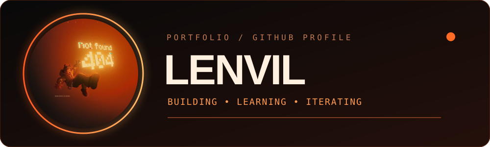
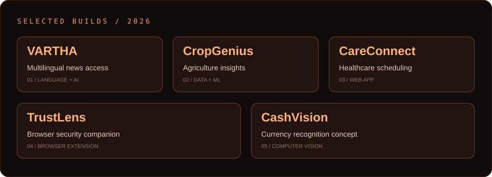

 

### `01 — ABOUT ME`

**Hey, I'm Lenvil.**

MCA student | Developer | Tech Enthusiast

I enjoy exploring technologies, building practical applications,
experimenting with ideas, and continuously learning.

---

<h2 align="center">02 — SELECTED PROJECTS</h2>

<table align="center">
<tr>
<td width="50%" align="center">

**VARTHA**

Multilingual news accessibility platform.

</td>
<td width="50%" align="center">

**CropGenius**

Agriculture insights and market information.

</td>
</tr>
<tr>
<td width="50%" align="center">

**CareConnect**

Healthcare appointment and reminder system.

</td>
<td width="50%" align="center">

**TrustLens**

AI-powered browser security companion.

</td>
</tr>
<tr>
<td colspan="2" align="center">

**CashVision**

Currency recognition project.

</td>
</tr>
</table>

---

<h2 align="center">03 — TECHNOLOGIES & TOOLS</h2>

---

<h2 align="center">04 — GITHUB ACTIVITY</h2>

  

---

### `05 — CONNECT`

  

**DESIGN. BUILD. EXPLORE. REPEAT.**

© Lenvil · Built with curiosity.

