  
   
  

<h2 align="center">About Me</h2>

  

<h2 align="center">Things I Build</h2>

  
  
  

<h2 align="center">Featured Projects</h2>

  

<h2 align="center">Tech Stack</h2>

  

  <a href="https://github.com/len-vil">GitHub Profile</a>
   
  Building, exploring and learning.

