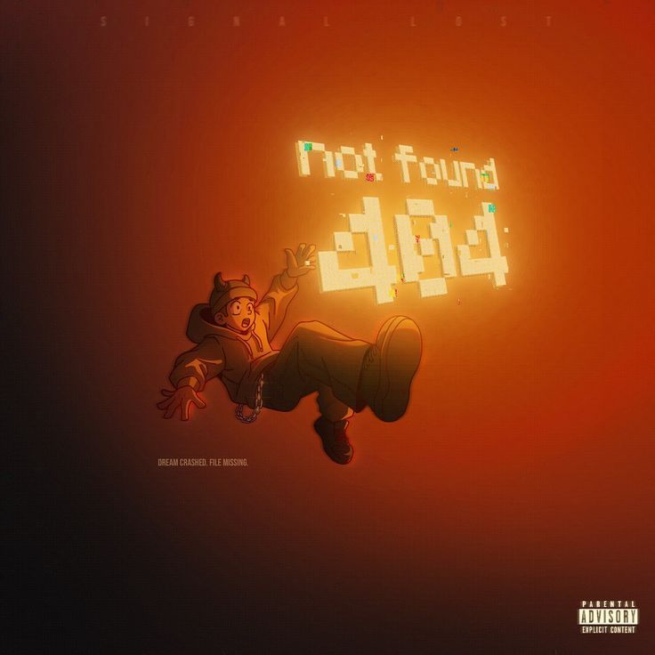
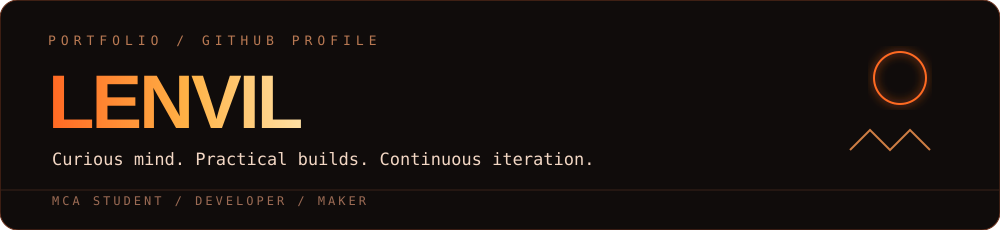

 

## `01 / PROFILE`

I'm **Lenvil** — an MCA student and developer interested in building useful digital products, experimenting with interfaces, and learning by making.

I enjoy working across the stack, from app interfaces to backend services and practical AI-powered tools.

## `02 / SELECTED WORK`

  

| PROJECT | FOCUS |
|:---|:---|
| **VARTHA** | Multilingual news accessibility |
| **CropGenius** | Agriculture insights and market information |
| **CareConnect** | Healthcare appointments and reminders |
| **TrustLens** | Browser security companion |
| **CashVision** | Currency recognition |

## `03 / TOOLBOX`

  

## `04 / ELSEWHERE`

<a href="https://github.com/len-vil">GITHUB</a>
&nbsp; / &nbsp;
<a href="https://github.com/len-vil?tab=repositories">REPOSITORIES</a>

  

DESIGN / BUILD / ITERATE — ONE COMMIT AT A TIME.

