<!-- Lenvil Pinto | Animated GitHub profile README -->

  
   
  

  

<h3 align="center">THREE THINGS I LIKE TO DO</h3>

  
  
  

<h3 align="center">SELECTED PROJECTS</h3>

  

  Made with curiosity, patience, and a little bit of coffee. · <a href="https://github.com/len-vil">@len-vil</a>

